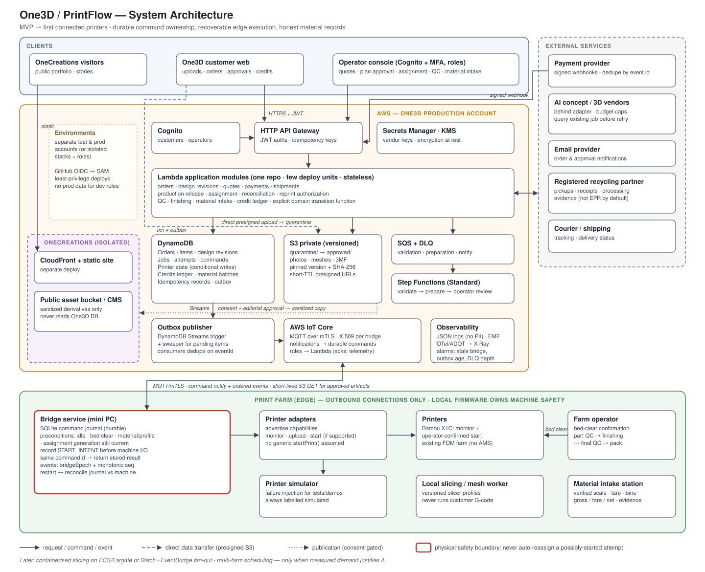

# One3D — V1 architecture

Status: **implemented** (V1 Checkpoints 1–8; see [IMPLEMENTED.md](IMPLEMENTED.md)); owner review and signoff pending · Decided 2026-10-07 · Reconciled with the code 2026-10-13

V1 is a bounded Java backend portfolio project for a fresher. It demonstrates a complete workflow, sound engineering and the ability to explain and operate the result. It is not the first release of the complete print-farm business.

The authoritative feature limits and completion gates are in [V1 scope](docs/v1-scope.md). This document describes its implementation structure. [The target architecture](docs/target-architecture.md) preserves the later business direction without adding V1 requirements. [IMPLEMENTED.md](IMPLEMENTED.md) records what was built and the evidence for it; this document alone does not establish that something works.

The previous Lambda/DynamoDB architecture and diagram are [archived](docs/history/architecture-2026-09-30.md). Their services, deployment phases and cost estimates are superseded.



## 1. The bounded workflow

A customer orders one configured catalog product, or submits one STL for manual review and a quote. The operator releases manufacturing, assigns one simulated printer, handles success or failure, checks the resulting part and marks the order ready for handoff.

- One seeded catalog product/configuration; one order line, quantity one.
- One part produced by one plate job; whole-part QC pass/fail.
- Custom requests contain one STL per submission revision, up to 20 MB.
- A new upload or changed requirements creates a new revision.
- Manual review, quote, production release and assignment.
- Razorpay test mode only; no live customer money.
- One independently restartable printer simulator; no physical printer control.
- A failed or rejected part can lead to an explicitly authorized replacement attempt.
- Manual readiness for handoff and handoff confirmation. Multi-part assembly, partial quantities and complex shipping are V2.

There is no basket, arbitrary workflow editor, automatic slicer, stock ledger, multi-printer scheduler or recycling-credit platform in V1. Scope expansion waits until the V1 completion checkpoint.

## 2. Stack and runtime boundaries

| Concern | Choice | Responsibility |
|---|---|---|
| Customer and operator UI | Next.js, React, TypeScript | One frontend with customer pages and `/ops` |
| Backend | Java 21, Spring Boot, Spring MVC | APIs, permissions and business rules |
| Persistence | PostgreSQL, Spring Data JPA/Hibernate | Relational records/transactions; explicit SQL where useful |
| Schema changes | Flyway | Reviewed, versioned migrations |
| Authentication | Spring Security OIDC with Cognito user pool | CUSTOMER and OPERATOR permissions enforced by backend |
| Files | Private S3 bucket | Direct upload and exact approved object references |
| Payments | Razorpay test mode | Checkout, verified callbacks and reconciliation exercises |
| Background work | PostgreSQL work/outbox rows and small Spring worker | Durable verification, dispatch and bounded retries |
| Simulator | Small Java process with SQLite journal | One virtual printer independent of backend restarts |
| Deployment | Docker Compose on small AWS EC2 instance | One understandable demo environment |
| Reverse proxy | Nginx | HTTPS and same-origin frontend/API routing |
| CI/CD | GitHub Actions | Tests, image build and controlled deployment |
| Infrastructure | Bounded Terraform configuration | Reproducible demo infrastructure and permissions |
| Monitoring | Actuator/Micrometer, Prometheus, Grafana | Restricted metrics, useful dashboard, failure investigation |

Versions are pinned through the Maven wrappers and Spring Boot's dependency management, `package-lock.json`, image tags and Terraform's lock file.

The backend is one deployable application. The simulator is separate to model execution that survives a backend restart, not to introduce a real edge platform. S3, Cognito and test payments have narrow client boundaries; the application does not communicate with its own feature packages over a network.

RabbitMQ, Kafka, Kubernetes, Jenkins and Ansible are optional, independently runnable labs. They are not V1 runtime dependencies or release gates. Do not maintain two CI systems for the same exercise or add a broker merely to increase the technology count.

## 3. Repository structure

```text
backend/                    one Spring Boot application (Maven wrapper)
  src/main/java/store/one3d/
    identity/ catalog/ requests/ quotes/ orders/
    payments/ production/ files/ background/
    common/                 shared errors, request ids, deployment guard
  src/main/resources/db/migration/   Flyway V1–V8
  src/test/java/...         unit tests and PostgreSQL/Testcontainers integration tests
frontend/                   Next.js (App Router), TypeScript
  src/app/                  customer routes and /ops
  src/components/  src/lib/ shared components and typed API access
  tests/                    Playwright smoke tests (API mocked)
simulator/                  the separate printer simulator (plain Java, SQLite journal)
infra/
  terraform/                bootstrap (state bucket) and demo (the AWS environment)
  nginx/                    local, bootstrap and https configurations
  monitoring/               Prometheus configuration, Grafana provisioning and dashboard
  deploy/  ops/             deploy scripts; start/stop, backups, restore check, instance replacement
  iam/  account/            the deployment user's policy; account budgets
  README.md                 the AWS runbook
.github/workflows/          ci.yml (tests, images, deploy), deploy.yml (redeploy a tested commit)
compose.yaml  compose.override.yaml  compose.deploy.yaml
docs/
  decisions/  evidence/     decision records; one evidence record per checkpoint
```

Optional labs have no directory; none was started.

Within a feature, use controller, request/response DTO, application service, domain/entity and repository classes as needed. Do not create every possible layer for every trivial operation. Add subpackages when actual size warrants them.

### Code rules

- Controllers map HTTP and validate input. Application services own use cases, permission checks and transaction boundaries.
- Domain methods enforce transitions. Do not expose generic `setStatus` endpoints.
- Return DTOs, not JPA entities or accidentally serialized relationships.
- Features own their writes behind small service interfaces. Avoid reaching through unrelated repositories.
- Use Bean Validation for request shape, domain checks for rules and consistent exception-to-HTTP responses.
- Prefer constructor injection, meaningful names and small methods. Avoid a framework of generic base services on top of Spring.
- Use pagination and deliberate queries; understand generated SQL and avoid loading complete object graphs.
- Keep configuration outside code and credentials outside Git/images. Document safe development defaults.
- Store money as integer minor units with currency; use explicit units for size and duration and consistent UTC timestamps.
- Use interfaces for actual boundaries such as storage/payment/simulator clients. Not every class needs an interface.
- Write short decision records for real tradeoffs. Do not implement speculative V2 abstractions.

## 4. Data model and invariants

| Boundary | V1 responsibility | Invariant |
|---|---|---|
| Identity | External subject and local permissions | Client-supplied customer IDs cannot grant access |
| Product / recipe revision | Catalog configuration and approved instructions | Later recipe edits do not change accepted orders |
| Custom request / submission revision | STL, requirements and review | Approval is tied to one immutable revision |
| Artifact | Owner, key/version, digest, size and validation state | Reference identifies the bytes actually verified |
| Quote revision | Manual price, scope, expiry and acceptance | Acceptance freezes one offer |
| Order / line snapshot | Agreed scope, money and handoff progress | One line, quantity one; no silent substitution |
| Payment / event receipt | Provider operation and money facts | Duplicate delivery cannot create a second release |
| Release / plate job | Explicit authorization for one part | Payment alone does not authorize execution |
| Attempt | One execution of a job | Replacement preserves earlier failures |
| Reservation / command | Ownership and durable instruction | One active owner; uncertainty retains ownership |
| Clearance / QC | Operator clearance and whole-part inspection | Idle does not mean clear; completion does not imply acceptance |
| Audit / pending work | Transition evidence and durable follow-up | No full event sourcing required |

Use foreign keys and database uniqueness rules. Bounded snapshots can use validated JSON; core relationships belong in ordinary relational records.

### Transaction boundaries

1. Accept one exact quote revision and create its order snapshot.
2. Record a verified payment/event and commercial eligibility.
3. Release the approved manufacturing scope once.
4. Reserve printer/job, create attempt and insert command/work record.
5. Record an observation and its allowed attempt transition.
6. Record QC and separately authorize replacement when necessary.

Use optimistic versions for ordinary edits and short locking/conditional-update transactions for contested reservations. Unique constraints protect provider identities and active ownership. Never hold a database transaction open while calling S3, payments or the simulator.

## 5. Security and files

### Identity and authorization

Use Spring Security OIDC login with Cognito and server-managed sessions. Cookies are HttpOnly and Secure in deployment; cookie-authenticated mutations have CSRF protection. For the single-backend demo, requiring login again after restart is an acceptable documented simplification.

Every endpoint checks role and object ownership. `/ops` is a UI grouping, not access control. Restrict role assignment and use operator MFA for the deployed demo. (Implemented: users are created by an administrator only, and Cognito requires TOTP for every user of the demo pool, because MFA is a pool-wide setting.) No Cognito identity pool or browser-held long-lived tokens are required.

### Immutable direct uploads

1. Authenticated customer requests an upload session for their request.
2. Backend allocates a random quarantine key and short-lived, size-bounded upload authorization.
3. Browser uploads directly to S3; Spring is not the binary upload path.
4. Finalization identifies the exact object version and queues verification.
5. A trusted worker checks ownership, actual size, basic STL structure and full-file SHA-256 while reading that exact version.
6. Finalized references pin that version and digest, or an exact verified copy in an application-controlled location.
7. Operator still determines suitability for the requested work.

Accept one STL up to 20 MB. Basic bounded checks do not prove mesh safety or manufacturability. Do not execute models or accept customer G-code. Advanced parsing/repair and 200 MB multipart transfer are V2.

Do not trust extensions, browser MIME types or client checksums. Presigned URLs are not one-use permissions; an object key alone is not immutable identity. Private signed downloads require ownership checks. Do not log signed URLs, private contents or tokens. Handle abandoned objects through a documented cleanup policy.

### Payment test boundary

Label the demo and checkout as test mode. Verify the webhook signature over the required raw body; validate amount, currency and provider identities before recording success. Unique provider event IDs and payment IDs address different duplicate cases. A browser success page is not payment evidence.

Test replay, invalid signatures and reordered events. Explicit release stays separate from payment. Live onboarding, taxation, deposits and advanced refund policy are V2 business requirements.

## 6. Jobs, attempts and simulator protocol

Keep lifecycle records separate:

```text
Custom request: submitted → under review → changes required / rejected / quote ready
Quote:          draft → issued → accepted / expired / withdrawn
Order:          awaiting payment → confirmed → ready for handoff → handed over
Production job: planned → released → executing → awaiting QC → accepted
Attempt:        created → start intent → running → completed
Exceptions:     rejected before start / confirmed failed / reconciliation required
QC:             pending → passed / failed
```

These describe behavior; implementation may use clearer enum names. Holds retain ownership until reconciled. QC rejection preserves the completed attempt and requires an operator action for replacement. Customer cancellation, refund coordination and a printer cancellation API are outside V1.

Track simulator connectivity, execution phase, bed occupancy and reservation independently. Completion/failure leaves the bed occupied or unknown until clearance. Consume the clearance for the next start.

### Durable one-printer simulator

Its small HTTP contract supports:

- Command submission with stable command ID, attempt ID and payload hash.
- Observation of current job identity, execution phase and bed occupancy.
- Documented failure injection through a private development control surface.

The simulator persists command identity before starting. Same ID/content returns the previous outcome; same ID/different payload is rejected. Save the simulated start, execution identity and consumed clearance durably before acknowledging the command, so a restart cannot count the same command as a new execution. Its SQLite journal survives restarts. It is always labeled simulated.

The backend records intent before dispatch. If the simulator starts but its reply is lost, reconcile through a known job identity. If identity cannot be established, retain ownership and require reconciliation. A timeout is not permission to start again.

Demonstrate duplicate delivery, lost start response, backend restart during printing, simulator restart, confirmed failure and occupied-bed refusal. No physical printer, MQTT, vendor adapter or controller failover is needed for V1.

## 7. Small durable worker

A transaction that creates required follow-up also inserts pending work. A worker claims rows, performs work and records outcomes. Use bounded retries, backoff, error reasons and operator-visible exhausted work. Recover abandoned claims after a crash.

This is at-least-once processing, not exactly-once external execution. Stable payment/simulator operation identities make supported retries safe. Do not turn uncertain starts into new attempts automatically.

No arbitrary workflow language, internal event bus or broker abstraction is required. Database records are authoritative; audit history explains changes without event-sourced persistence.

## 8. Deployment and tool exercises

Start locally with Docker Compose, named volumes and synthetic data. A small EC2 instance may host the app and PostgreSQL for the demo; document the single failure domain. Managed PostgreSQL is a later operating decision, not a hiring prerequisite.

Terraform covers only chosen demo infrastructure, storage and scoped permissions. Understand and protect its state; never commit sensitive state or credentials. GitHub Actions tests before deployment and uses a narrowly scoped identity, preferably OIDC federation. Keep a previous working image for rollback; destructive migrations need a separate recovery plan.

Nginx provides HTTPS and same-origin routing. Expose intended web endpoints only. PostgreSQL, simulator, Prometheus, Grafana administration and Actuator management endpoints must not be anonymously reachable from the internet. Retrieve runtime secrets through a documented protected mechanism.

Practice database backup and restore. Stop dispatch during restoration and reconcile restored commands with the independently persisted simulator before resuming: a restored database may contain commands already executed by the simulator.

## 9. Verification and evidence

- Unit tests: quote expiry, revision checks, transitions and QC gates.
- PostgreSQL integration tests: uniqueness, transaction behavior and competing reservations, with real PostgreSQL or Testcontainers.
- API tests: customer ownership and operator-only operations.
- Controlled storage/payment integration checks in test mode.
- Simulator failure tests: duplicates, dropped responses and restarts.
- One end-to-end demonstration of the bounded customer/operator workflow.

Do not substitute an in-memory database and assume PostgreSQL transaction behavior is identical. Critical invariants need explicit tests; an arbitrary coverage percentage does not establish correctness.

Use structured logs with request/order/job/attempt/command IDs. Keep unbounded IDs out of metric labels. The initial Prometheus/Grafana exercise covers API errors and latency, pending-work age and failure/reconciliation count. Inject and diagnose one fault; keep monitoring access restricted.

Record actual results in [IMPLEMENTED.md](IMPLEMENTED.md) and the evidence location defined by [V1 scope](docs/v1-scope.md). Distinguish planned, implemented, tested and deployed. Simulated printer behavior is not production manufacturing evidence.

## 10. Stop at completion

Complete the scope checkpoints, demonstrate the workflow and explain the critical code independently. Update the résumé using evidenced capabilities, then freeze/tag the completed release before increasing scope.

The next increment follows measured gaps and [V2 gates](docs/target-architecture.md), not unused technologies. OneCreations stays a separate public site and receives no private customer assets, order records or shared deployment credentials.
