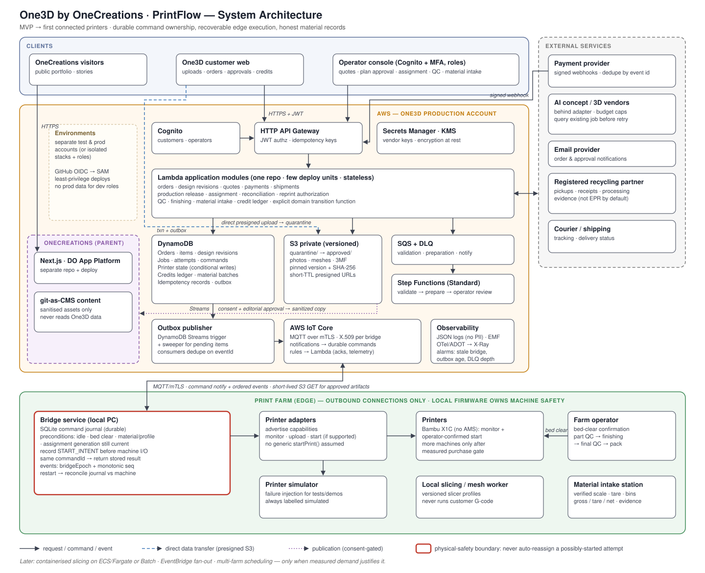

> **Historical snapshot — superseded on 2026-10-07.** This document preserves the previous architecture for context. Its stack, deployment phases, domains, cost estimates and regulatory statements are historical assumptions, not current build instructions or current advice. Follow [the current architecture](../../ARCHITECTURE.md) and [V1 scope](../v1-scope.md). Relative document and diagram links have been adjusted for this archive location.

# One3D by OneCreations / PrintFlow — Architecture

Status: draft · Last reviewed: 2026-09-30



## 1. Purpose and scope

PrintFlow is the order-to-shipment system behind **One3D by OneCreations**, the custom-collectible and small-batch 3D printing business of the OneCreations studio. It will also run **PrintBack**, a documented take-back and material-ledger program, once a real collection route exists. **OneCreations** is the parent brand and public portfolio. It is a separate Next.js app in its own repository and deployment.

```
OneCreations (parent studio, portfolio)      onecreations.in
└── One3D by OneCreations (business)         make.onecreations.in        customer app
    ├── PrintFlow (internal software)        ops.make.onecreations.in    operator app
    └── PrintBack (later)                    collection, credits, "Make from your material"
```

Business context, budget and unit economics are in [docs/business-plan.md](../business-plan.md). Brand, sites and journeys are in [docs/brand-and-websites.md](../brand-and-websites.md). PrintBack economics and claims are in [docs/printback.md](../printback.md). Delivery sequencing is in [docs/roadmap.md](../roadmap.md).

The system is built as a small, well-instrumented manufacturing application with explicit physical safety boundaries. The engineering priorities are:

1. durable job ownership and recoverable edge execution;
2. immutable design revisions and approved manufacturing artifacts;
3. measured production cost and capacity (machine, sculpting and finishing time);
4. honest, reconcilable material and credit records.

Adding more cloud services is not a goal. Each service needs a reason to be there.

## 2. Architectural principles

- **Physical side effects are never "exactly once" by infrastructure.** SQS, MQTT, Lambda retries and Step Functions cannot guarantee that a printer starts exactly once. The command journal and reconciliation handle this.
- **Never automatically reassign an attempt that may already have started.** When the system cannot tell whether a print started, the state is `RECONCILIATION_REQUIRED` and a person resolves it.
- **Commands are not events.** `StartPrintRequested` is not `PrintStarted`.
- **Business commands, not "set status".** Transitions go through a domain function that checks the current state, the actor's permissions and the expected revision.
- **Immutable references.** Production uses exact S3 object versions and SHA-256 checksums. It never uses "the latest file at this key".
- **Humans own artistic and physical-safety judgement.** Automation covers file checks and scheduling. People own likeness, anatomy, support placement, bed-clear confirmation and QC release.
- **Cloud connectivity is not an emergency stop.** Local firmware and local safety controls own the machine.
- **Replaceable vendors.** AI, mesh-prep tools, payment and printers all sit behind small adapters, and neutral exports (STL/OBJ/3MF) are kept.

## 3. Phases

| Phase | Scope |
|---|---|
| **MVP / first paid orders** | Static OneCreations site. One3D customer and operator web apps. HTTP API Gateway → Lambda modules. Private S3, DynamoDB, Cognito, payment provider, email. SQS + DLQ for async validation. One Step Functions Standard workflow: *asset validation → preparation → operator review*. Quoting, slicing, assignment and bed-clear confirmation are **manual**. One repo, a few deployment units, no microservice fleet. |
| **First connected printer** | The existing Bambu X1C (no AMS) is the only machine at the start. More compatible machines are added only after the [purchase gate](../business-plan.md#printer-purchase-gate). Bridge service on an existing computer or mini PC. AWS IoT Core with one X.509 certificate per bridge (mTLS, outbound only). Durable command table plus edge SQLite journal. Short-lived S3 URLs for approved artifacts. Immutable print attempts, reconciliation, metrics and alerts. The Bambu X1C starts with **monitoring and operator-confirmed dispatch** until the firmware integration path is verified. |
| **Later** | Containerised mesh/slicing workers: local first, then ECS/Fargate or AWS Batch when demand is measured. EventBridge once several consumers need the same event. Full material inventory, credit ledger, partner receipts and reconciliation. Scheduling optimisation, multiple farms and analytics, but only after there is operational data to justify them. |

Test and production live in separate AWS accounts if manageable. Otherwise they use separate stacks and roles, and development roles cannot read production data.

## 4. Components

### 4.1 Clients

| Client | Purpose | Auth |
|---|---|---|
| OneCreations site (parent) | Public portfolio and editorial stories. It links to One3D via `NEXT_PUBLIC_ONE3D_URL`. | None (public) |
| One3D customer web | Uploads, orders, approvals, payments, credits, provenance | Cognito, or a restricted guest upload session |
| Operator console | Quotes, plan approval, slicing hand-off, assignment, QC, finishing, material intake | Cognito with MFA and explicit roles. A hidden URL is not access control. |

### 4.2 Cloud (AWS)

| Component | Responsibility |
|---|---|
| **Cognito** | Customer and operator identity, JWTs, operator MFA. |
| **HTTP API Gateway** | JWT authorisation and routing. Mutating endpoints require an idempotency key. |
| **Lambda application modules** | Orders, design revisions, quotes, payments, production release, assignment, reconciliation, QC, finishing, material intake and the credit ledger. Stateless. All state lives in DynamoDB/S3. |
| **DynamoDB** | Operational state, a few tables split by responsibility. Conditional transactions, idempotency records and the transactional outbox. |
| **S3 (private, versioned)** | Customer photos, meshes, 3MF files and slicer projects. Objects move from `quarantine/` to `approved/` and are referenced by version and checksum. |
| **SQS + DLQ** | Asynchronous compute backlog: validation, preparation, notifications. Printers do **not** consume this queue. |
| **Step Functions (Standard)** | Longer workflows with human approval, starting with validation → preparation → operator review. Payloads carry S3 references, never the models themselves. |
| **Outbox publisher** | DynamoDB Streams triggers publishing. A sweeper queries pending outbox items as a recovery path. Consumers deduplicate. |
| **AWS IoT Core** | MQTT over mTLS to bridges. Notifications point to durable commands. The credential provider exchanges a bridge certificate for scoped, short-lived AWS credentials if direct S3/SQS access is ever needed. |
| **Secrets Manager / KMS** | Vendor keys and encryption at rest. |
| **Observability** | Structured JSON logs, EMF metrics, OpenTelemetry/ADOT → X-Ray, and alarms. |

### 4.3 Edge (print farm)

| Component | Responsibility |
|---|---|
| **Bridge service** (existing mini PC) | Holds the durable SQLite command journal, checks preconditions, records `START_INTENT`, sends machine I/O through adapters, uploads events in order, and reconciles after a restart. Makes outbound connections only. |
| **Printer adapters** | Each adapter declares what it can do (`monitor`, `upload`, `start`, `pause`, `jobId`). The system never assumes a generic `startPrint()`. |
| **Printers** | One Bambu X1C (no AMS) at the start, with monitoring plus operator-confirmed start until the LAN / Developer Mode path is verified on its firmware. Further machines are added only when a measured printing bottleneck passes the purchase gate. A few repeatable configurations are preferred over a mix of flagships. |
| **Printer simulator** | Deterministic failure injection for tests and demos. Its output is always labelled as simulated. |
| **Local slicing / mesh worker** | Controlled, versioned slicer profiles. Machine instructions are always generated from those profiles. Customer-supplied G-code is never run. |
| **Operator station** | Bed-clear confirmation, part QC, finishing, final QC. |
| **Material intake station** | Verified scale, tare containers, labelled bins and evidence capture. |

### 4.4 OneCreations boundary

OneCreations is the parent brand, but technically it is an independent system: a Next.js 16 app (`harsha135135/OneCreations`) on DigitalOcean App Platform (`blr`). Its content is git-as-CMS, stored as typed arrays in `web/lib/*.ts` and edited through a local-only admin console. It never queries One3D's production database or storage, and One3D never depends on it.

Publishing is one-way:

```
One3D order completed → PublicationPermission recorded → editorial selection
→ sanitised derivative photos + story → OneCreations content entry (commit) → deploy
```

OneCreations links back to One3D (header, home section, "Create yours" on printed pieces) through a single `NEXT_PUBLIC_ONE3D_URL` setting.

- **Shared between the two sites:** UI primitives, schemas, build tooling and approved derivative assets.
- **Never shared:** customer photos, raw models, addresses, credits, payment records, authentication and IAM/deploy permissions.

## 5. Domain model

One status field with 20+ stages would mix several independent lifecycles, so the model keeps them separate:

| Entity | Meaning |
|---|---|
| Order | Commercial agreement, customer, payment, promised delivery |
| Order item | Product specification and quantity |
| Design revision | Immutable geometry/concept version and its approvals |
| Manufacturing plan | Approved revision, parts, quantities, material, process |
| Part | A required physical component |
| Build-plate job | One planned build containing one or more parts |
| Print attempt | One actual execution of a job |
| QC inspection | Evidence, measurements, accept/reject |
| Finishing task | Assembly, sanding, painting, packing |
| Shipment | Fulfilment and tracking |
| Material batch | Physical input/output inventory |
| Quote version | Immutable priced offer. Accepting it freezes price, scope and delivery commitment. |
| Approval | Customer or operator sign-off on a specific design revision or quote version |
| Material lot | A spool or batch of filament, or recovered material, with supplier, polymer, colour and rate-card cost |
| Material movement | Consumption, transfer, split/merge or scrap of a lot, in integer grams |
| Credit entry | Immutable financial or loyalty movement with a reason |
| Credit reservation | Hold of credits against an order until the payment outcome is known |
| Publication permission | Customer consent to publish, kept separate from manufacturing and AI-processing consent |

> Example: an order with 8 parts might need 3 build plates, one of which fails once. That is **1 order, 3 jobs and 4 attempts**. Metrics and costs always state which of these they count.

### 5.1 Lifecycles

```
Order:      DRAFT → DESIGN_IN_PROGRESS → AWAITING_APPROVAL → APPROVED → PRODUCTION
            → FINISHING → READY_TO_SHIP → SHIPPED → DELIVERED   (+ ON_HOLD, CANCELLED)
Payment:    PENDING → PARTIALLY_PAID → PAID → REFUND_PENDING → REFUNDED
Design:     WORKING → REVIEW_REQUIRED → APPROVED → SUPERSEDED
Attempt:    PLANNED → RESERVED → READY → START_INTENT → RUNNING → PRINT_COMPLETED → QC_PASSED
            (+ FAILED_CONFIRMED, CANCELLED_BEFORE_START, RECONCILIATION_REQUIRED, QC_REJECTED)
Credit:     ISSUED · AVAILABLE · RESERVED · REDEEMED · RELEASED · REINSTATED · REVERSED · EXPIRED
Printer connectivity: ONLINE / STALE / OFFLINE
Printer physical:     IDLE / RUNNING / PAUSED / ERROR / UNKNOWN
```

Rules:
- `OFFLINE` describes connectivity. It does not prove that a print failed.
- A customer revision creates a **new** design revision. It never overwrites geometry that an active print is using.
- A reprint creates a **new** attempt with a reason and a cost attribution. The failed attempt's material and time stay on record.
- Parts are inspected before assembly, and there is a final QC after finishing so that painting and assembly defects are caught.
- A credit redemption is allowed only up to `min(balance, published cap, contribution before credits − contribution floor)`. A flat percentage cap can exceed the entire margin of a custom order (see [docs/printback.md §3](../printback.md#3-a-percentage-cap-does-not-protect-margin)).

## 6. Physical dispatch protocol

The most important invariant: **never automatically reassign an attempt that may already have started.**

```
Operator/scheduler         Cloud (DynamoDB)                 Bridge (SQLite)            Printer
      │ select printer            │                                │                       │
      ├──────────────────────────►│ TX: reserve printer (cond.)    │                       │
      │                           │     + bump job version         │                       │
      │                           │     + create immutable attempt │                       │
      │                           │     + write command + outbox   │                       │
      │                           ├── IoT notify(commandId) ──────►│ persist command       │
      │                           │                                │ check: idle, bed clear│
      │                           │                                │  material/profile,    │
      │                           │                                │  generation current   │
      │                           │                                │ record START_INTENT   │
      │                           │                                ├── supported start ───►│
      │                           │                                │ record result + jobId │
      │                           │◄── ordered events (epoch, seq) ┤                       │
```

The command carries: `commandId`, `attemptId`, `printerId`, assignment `generation`, approved artifact version and checksum, profile version, and preconditions.

- Receiving the same `commandId` again returns the stored result. It never starts the printer a second time.
- If the bridge crashes between `START_INTENT` and a recorded result, the outcome is **uncertain**. If the adapter cannot prove whether printing started, the attempt goes to `RECONCILIATION_REQUIRED` and someone inspects the printer.
- **Leases** control who may *prepare* an unstarted assignment. When a lease expires it never releases a print that may be running.
- **Fencing generations** let the edge reject stale commands. They cannot revoke a command already delivered to a disconnected machine.
- **Offline policy (MVP):** a known active print continues under firmware control. The bridge buffers telemetry and blocks new starts, then reconciles when the connection returns.
- After a bridge restart, it reconciles its journal against the actual machine state before it accepts new work.

## 7. Failure handling

| Failure | Recovery |
|---|---|
| Duplicate queue/MQTT delivery | Return the previous command result |
| AI provider timeout | Query the existing vendor job before paying for another request |
| Repeated upload event | Revalidate the same immutable asset version (idempotent) |
| Slicer transient error | Bounded retries, then DLQ and human review |
| Invalid geometry | Human repair. Retrying unchanged input is pointless. |
| Printer unreachable before a proven start | Reconcile. Reassign only after proving the print did not start. |
| Printer unreachable during a print | Mark `STALE`/`UNKNOWN` and keep ownership |
| Confirmed failed print | Record the material and time used, inspect the machine, approve a new attempt |
| QC failure | Keep the failed inspection and create rework or a reprint with its cause |
| Duplicated payment webhook | Apply each provider event once |
| Repeated credit issuance | The same transaction key returns the same ledger result |

## 8. Data design

### 8.1 DynamoDB access patterns

| Access pattern | Key / index |
|---|---|
| Order with items and revisions | `PK=ORDER#id`, `SK=META / ITEM#id / REV#id` |
| Customer's recent orders | GSI `CUSTOMER#id`, sort `createdAt#orderId` |
| Job and its attempts | `PK=JOB#id`, `SK=META / ATTEMPT#id / EVENT#time#id` |
| Ready work at a farm | Sparse GSI `FARM#id#READY`, sort `priority#dueAt#jobId` |
| Printer current ownership | `PK=PRINTER#id`, `SK=STATE` (conditional writes) |
| Printer history | `PK=PRINTER#id`, `SK=ATTEMPT#time#id` |
| Pending commands for a bridge | `PK=BRIDGE#id`, `SK=COMMAND#time#id` |
| Credit balance and history | `PK=ACCOUNT#id`, `SK=BALANCE / ENTRY#time#id / HOLD#id` |
| Material batch and movements | `PK=BATCH#id`, `SK=META / MOVE#time#id / EVIDENCE#id` |
| Unpublished events | Pending-outbox GSI (bucketed later if traffic warrants) |
| Duplicate request check | `PK=IDEMPOTENCY#actor#operation#key` |

- GSIs are for listing candidates only. The authoritative record is re-checked inside a conditional transaction before assignment.
- There is no global `PK=QUEUED` partition, and no scan on every dashboard refresh. A ten-printer farm does not need sharding yet.
- Money is stored as integer paise, credits as integer credit units and mass as integer grams. Every record keeps its rate-card version.
- **Material rate card.** Filament cost is stored per lot as paise per kg, with a versioned rate card. Attempt cost is computed from the grams consumed (including failed attempts) × the lot's rate. The first rate-card version is Numakers pricing (2026-09):

  | Filament | Paise/kg |
  |---|---|
  | PLA+ | 65,000 |
  | PLA Matte | 70,000 |
  | Specials | 90,000–100,000 |
  | PETG | 65,000 |

  PETG lots and scrap are never merged with PLA or PET.

### 8.2 Transactions

- Reserve printer, bump job version, create attempt and create outbox record.
- Approve design, write the approval snapshot and create an event.
- Accept a material batch, create a credit entry, update the balance and create an event.
- Reserve credit and create an order hold, then settle or release the hold once the payment outcome is verified.

### 8.3 Event envelope and outbox

```
eventId, eventType, schemaVersion,
aggregateType, aggregateId, aggregateVersion,
occurredAt, receivedAt, actorId,
correlationId, causationId,
orderId?, jobId?, attemptId?,
payload
```

Core events: `AssetValidated`, `DesignApproved`, `QuoteAccepted`, `PaymentCaptured`, `ProductionReleased`, `AttemptReserved`, `PrintStartConfirmed`, `PrintCompleted`, `QCRejected`, `ReprintAuthorized`, `FinishingCompleted`, `ShipmentDispatched`, `MaterialAccepted`, `CreditIssued`, `CreditReserved`, `CreditRedeemed`, `RecyclerReceiptRecorded`.

The state change and its outbox item are written in the same transaction. Streams trigger publishing, and a sweeper covers anything the stream misses (stream retention is only 24 h). A pending item stays until it is delivered or escalated. If publishing succeeds but the "mark delivered" write fails, the event goes out twice, so consumers deduplicate on `eventId`. TTL is only for cleanup. It never authorises a lease, expires spendable credit or enforces a deadline.

Reporting across orders uses S3 exports or analytical summaries. DynamoDB is the operational store, not the long-term accounting database.

## 9. API surface

```
POST /uploads                              POST /jobs/{id}/assignments
POST /uploads/{id}/complete                POST /attempts/{id}/reconcile
POST /orders                               POST /attempts/{id}/qc-inspections
GET  /orders/{id}                          POST /attempts/{id}/reprint-authorizations
POST /orders/{id}/design-approvals         POST /finishing-tasks/{id}/complete
POST /quotes/{id}/accept                   POST /material-intakes
POST /orders/{id}/production-release       POST /material-intakes/{id}/accept
POST /payments/provider-webhook            POST /credit-reservations
GET  /jobs?farmId=&state=&cursor=          POST /credit-adjustments
GET  /accounts/me/credits                  GET  /objects/{publicToken}/provenance
```

Mutating endpoints take an idempotency key and, where relevant, an expected revision. The server checks ownership and whether the transition is allowed. It never trusts account or tenant identifiers supplied by the client.

## 10. Security

### 10.1 Upload pipeline

1. Authenticate, or issue a restricted guest upload session.
2. Allocate a random object key owned by the server, under the right account and order.
3. Issue a short-lived presigned POST with restrictions. A presigned URL can be reused until it expires and can overwrite an existing key, so it is not a one-use permission.
4. The browser uploads directly to private S3 `quarantine/`.
5. The server checks the actual size, content, checksum and ownership.
6. Process with strict CPU, memory and decompression limits. 3MF is a zip container, so the pipeline guards against archive bombs and path traversal. Extensions and MIME headers are not treated as validation.
7. Promote to `approved/`. From then on, only that exact version and hash are referenced.

### 10.2 AI vendor isolation

Vendors sit behind `createConcept`, `submitModelJob`, `getStatus` and `downloadResult`. Each call stores the provider, model/version, prompt-template version, input hashes, vendor job ID, spend and approval history.

- Budget caps per order and per customer. Bounded retries and a circuit breaker.
- After an ambiguous failure, query the existing vendor job before spending again.
- Vendor callbacks are verified and protected against replay. Downloaded outputs are treated as untrusted uploads.
- Customer photo consent, minimal retention and the vendor's privacy terms are all recorded.
- Manual sculpting remains the fallback.
- **No AI agent may issue machine commands, approve its own work or change the credit ledger.**

### 10.3 Identity and operations

- Each bridge has its own X.509 certificate. There are no long-lived IAM keys or homemade API tokens on edge devices.
- Deploys use GitHub OIDC with least-privilege roles.
- Vendor secrets live in Secrets Manager and are rotated.
- Operator actions are audit-logged, and backups are tested.

## 11. Scheduling

Start with a deterministic, explainable policy:

1. Filter on hard constraints: capability, material, nozzle/profile, build volume, machine health, enough material, and an available operator and bed.
2. Sort by promised date and priority.
3. Prefer the eligible printer with the earliest expected completion, including setup and turnover time.
4. Require operator confirmation at first.
5. Record why each assignment was made and how accurate its estimate was.

An order can only move to assembly when its last missing part is done. Keeping every printer busy can lengthen lead times by flooding finishing with work, so work in progress and finishing capacity are tracked alongside printer availability.

Accepted orders are limited by whichever resource runs out first, and demand includes failed attempts and rework:

$$
\text{Monthly accepted orders} \le \min\left(\frac{\text{machine hours}}{\text{machine h/order}},\ \frac{\text{sculpting min}}{\text{sculpting min/order}},\ \frac{\text{finishing min}}{\text{finishing min/order}}\right)
$$

No scheduling model gets trained until a simple heuristic has a measured baseline.

## 12. Manufacturing workflow integration

The process is chosen per product and recorded in the manufacturing plan:

| Product | Starting route | Main constraint |
|---|---|---|
| Stylised bust, chibi, larger simple collectible | X1C FDM, single material (no AMS), controlled finishing | Sanding/painting time |
| Small realistic face, jewellery, hair, delicate accessories | Outsourced resin sample compared against FDM | Detail, support damage, breakage |
| Large premium figurine | FDM body/base plus separate detail parts if justified | Assembly, fit, consistency |
| Repeat creator collectible | Approved master with a repeatable bill of materials and finishing recipe | Per-unit painting labour |
| Functional part | Qualified material and orientation | Anisotropy, tolerances, environment |

**Mesh pipeline:**

```
original source → reviewed prepared mesh → per-part exports → versioned slicer project → approved production artifact
```

- **Automated checks:** file integrity, units and dimensions, topology, disconnected components, minimum features, thumbnails, connector generation, validated slicer presets.
- **Human release gate:** likeness, anatomy, hidden surfaces, fragile features, support placement, final orientation.
- **Golden model suite:** faces, fingers, jewellery, hair, fur, fabric, thin props and keyed joints. Every tool is measured against it.
- Third-party prep tools such as Audja (public beta, no verified unattended API) are operator tools behind this file boundary. A proprietary project file is never the only manufacturing record.

Time is logged per stage: intake, concept, revisions, sculpting/repair, slicing and setup, support removal and sanding, assembly, painting, QC, packing and rework. Each stage records both *active human minutes* and *elapsed time*.

## 13. Material and circularity ledger (PrintBack)

At first, PrintBack means documented collection through registered recycling partners, plus a clean internal scrap program. There is no in-house processing of household plastic until recovered material has a proven buyer, a qualified process and repeat volume.

### 13.1 Material states

```
received → inspected → accepted (dry polymer) → stored → shipped → partner received
        → processed → qualified output → incorporated in product
```

A shipment is not recycling. Qualified output sitting in storage has not yet displaced any virgin material. Internal regrind is never counted again as new collection.

Each record keeps gross weight, tare, contamination, moisture correction, accepted weight, polymer confidence, source, scale and operator, transfers, output lots, losses and evidence.

### 13.2 Acceptance policy (enforced in intake)

| Stream | Initial policy |
|---|---|
| Own clean PLA / PETG scrap | Segregated by formulation and source. PETG is kept separate from PLA and from PET. |
| Customer PLA/PETG prints | Accepted conditionally with provenance. Unknown coatings or fillers are quarantined. |
| PET bottles, HDPE, PP, film | Partner collection only, against the partner's specification |
| ABS/ASA, nylon, composites | Excluded from the first internal process |
| Painted or glued figurines | Assessed for repair or disassembly. Kept separate from clean scrap. |
| Cured photopolymer resin | Excluded from thermoplastic recycling. Goes to a local compliant waste route. |
| Unknown mixed plastic, PVC, multilayer, dirty waste, "old toys" | Not accepted automatically and earns no credit |

### 13.3 Mass balance and metrics

All figures use the same dry-mass basis:

$$
\text{opening inventory} + \text{external inputs} = \text{qualified outputs} + \text{residues/losses} + \text{closing inventory}
$$

Any unexplained balance error is reported, never forced to zero. Virgin additions, recovered polymer and non-polymer additives are tracked separately.

$$
\text{Acceptance rate} = \frac{\text{accepted}}{\text{received}} \qquad
\text{Recycling yield} = \frac{\text{qualified recycled output}}{\text{accepted feedstock processed}} \qquad
\text{Product recycled fraction} = \frac{\text{verified recycled polymer incorporated}}{\text{declared product mass}}
$$

Every figure states its denominator. Estimated virgin displacement is $D = \sum_p R_p \times s_p$, using a documented substitution factor $s_p$. If there is no defensible substitute, $s_p$ is zero or "unknown". Displaced polymer mass is not avoided CO₂.

### 13.4 PrintBack and "Make from your material"

- **PrintBack:** a pooled stream with documented custody. Credits are based only on verified acceptance.
- **Make from your material** (previously planned as the separate "RePrint" brand, now postponed): a premium service inside PrintBack. It is a paid feasibility assessment followed by a segregated batch. It promises batch identity only when the process can actually preserve it, and discloses minimum input, losses, virgin additions, colour variation and the fallback if it fails.

### 13.5 Claims and regulatory constraints the software must respect

- Print Credits, collection receipts and EPR certificates are different records and are never the same entity. Only registered processors can issue EPR processing certificates, and EPR revenue is excluded from the base financial model. Plastic EPR operations now run on CPCB's Common EPR portal.
- Public provenance and claims pages show measured quantities, scope, dates, exclusions and evidence status (CCPA 2024 greenwashing guidelines). They never use blanket "eco-friendly", "zero-waste" or "closed-loop" wording.
- Recycled-content labels follow G.S.R. 237(E) (31 Mar 2026) and IS 14534:2023 where they apply.
- All demo data is labelled synthetic unless it was actually weighed.

## 14. Observability

- **Logs:** JSON with IDs, state version, error class, duration and cost category. No PII, photo URLs, tokens, presigned URLs or raw vendor payloads.
- **Business metrics:** paid orders, contribution margin, design minutes, revisions, acquisition cost, refunds.
- **Production metrics:** queue time, attempt success, first-pass yield, active hours, operator minutes, setup time, rework cost, estimate error.
- **Reliability metrics:** API latency and errors, stale bridges, outbox age, oldest SQS message age, DLQ depth, stuck approvals, reconciliation count.
- **Circularity metrics:** accepted and rejected mass, inventory, confirmed external processing, yield, unexplained balance.
- **Cost metrics:** $ per job, per attempt, per accepted product, and per GB retained.

Order, job and attempt IDs belong in logs and traces, not in metric dimensions. Tracing uses OpenTelemetry/ADOT with X-Ray as the destination. The X-Ray SDK and daemon have been in maintenance mode since 2026-02-25, so new code does not use them. Cloud and edge spans are linked by correlation IDs. A trace is never held open for the days an order takes.

## 15. Platform constraints that shape the design

| Constraint | Consequence |
|---|---|
| Lambda on-demand max 15 min | Long slicing and mesh jobs run on workers or containers |
| SQS visibility max 12 h from first receive | Ack once responsibility is durably handed over. Never hold a message for a 30-hour print. |
| Step Functions Standard ≤ 1 year; Express ≤ 5 min | Standard for approvals. Idempotent side effects are still required. |
| Step Functions payload 256 KiB; 25,000 history events | Pass S3 references and checksums. Keep telemetry out of workflow history. |
| DynamoDB transaction: 100 actions / 4 MB, one action per item; client token lasts 10 min | Application-level idempotency records for payments and manufacturing |
| DynamoDB Streams retention 24 h | The stream is not the audit log. Pending outbox items plus the sweeper cover recovery. |

## 16. Cost model (illustrative)

Rough estimate at US-East reference rates, as of 2026-09. Recalculate for the India region before deploying. A "job" is one build-plate work item.

| Driver | ≈ $/job |
|---|---|
| S3 storage (0.3 GB, 3-month retention) | 0.0207 |
| Internet egress (0.2 GB) | 0.0180 |
| Step Functions (40 transitions) | 0.0010 |
| Logs (1 MB) | 0.0005 |
| Lambda, API GW, DynamoDB, SQS, EventBridge, S3 requests | ~0.0004 |
| **Total variable** | **≈ 0.041** |

| Jobs/month | Variable | + $25 operating allowance | Preliminary budget |
|---|---|---|---|
| 100 | $4 | $29 | $30–50 |
| 1,000 | $41 | $66 | $65–100 |
| 10,000 | $406 | $431 | $430–650 |

Storage and egress dominate, not orchestration. A 100 KB camera snapshot every minute is about 4.3 GB per printer per month, and continuous video would need its own budget. The model excludes AI generation, GPU or cloud slicing, SMS/WhatsApp, heavy traffic, tax, support plans and local hardware and electricity.

## 17. Repository layout

Two independently deployable repositories:

```
harsha135135/OneCreations    parent portfolio site (Next.js, DigitalOcean) and approved public content
harsha135135/One3D           customer app, operator app and PrintFlow (this repo)
```

Planned One3D layout (today the repo holds only these docs):

```
apps/        customer/  operator/
packages/    domain/  contracts/  ui/
services/    api/  workers/  notifications/
edge/        bridge/  adapters/bambu/  simulator/
infra/       sam/
tests/       integration/  failure/  fixtures/
docs/        architecture/  decisions/  runbooks/  measurements/
labs/        certification/
```

Directories are for organising code. A directory is not automatically its own deployable service. Design tokens and basic UI primitives may be shared with OneCreations. Storage, identity, customer assets, financial records and deploy permissions are never shared.

## 18. Acceptance demo

1. Upload a model (real, or a clearly marked sample) and show validation and the immutable revision.
2. Approve the quote and plan, and show the transaction and job creation.
3. Assign the job to a simulated printer and show the command ID and edge acknowledgement.
4. Deliver the same command again and show that there is no second start.
5. Disconnect the bridge during an active attempt. Ownership is kept and the attempt goes to `RECONCILIATION_REQUIRED`.
6. Reconnect and reconcile, and show the correct physical status.
7. Show a confirmed failure becoming a new authorised attempt, with the original attempt's cost kept.
8. End on the measurement dashboard and one real production example, labelled separately from the simulation.

## 19. Open items to verify before build

- The supported Bambu X1C integration path and firmware capabilities, which determine the adapter's capability set.
- India-region pricing, and whether the region supports every service used.
- Resin and solvent disposal route (from the SDS and a local authority), plus SPCB/PCC consents before any processing equipment.
- Contracts with the recycling partner: registration, stream specifications, and ownership of environmental attributes.
- Payment provider webhook signing and replay semantics.
- Trademark and domain clearance for "One3D" (IP India search). Otherwise launch as "OneCreations — Custom Manufacturing".
- Whether One3D registers for GST, which affects whether input credit applies to filament. Also a CA classification of goods, design services, printing services and waste-for-credit.
- DPDP Rules phase-in dates, and a retention schedule for source photos, models and invoices.
