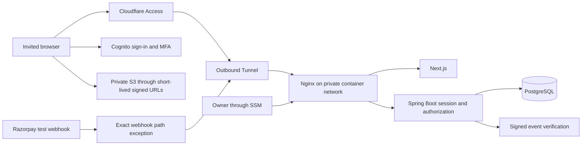

# Private recruiter demo: proposed access design

Status: **design only, not configured or verified**. Date: 2026-10-14.
The existing AWS environment and DNS have not been changed by this preparation.

## Decision

Use Cloudflare Access and an outbound Cloudflare Tunnel for browser-based temporary
invitations. Keep `demo.one3d.store`; keep Cognito's existing customer/operator roles.
Use Cloudflare Pages for the separate public page if the zone moves to Cloudflare.
Hostinger can remain the registrar. Changes to nameservers, ingress, containers and
access policies require approval of the concrete cutover plan.

| Option | Benefit | Cost or limitation |
|---|---|---|
| Access + Tunnel | Named email allowlist, browser login, revocation; no inbound origin ports | Another identity gate and tunnel process; DNS/account setup; webhook exception requires care |
| Tailscale Serve | Suitable for owner access and screen-sharing; private tailnet service | Reviewer/client onboarding and hostname/callback changes; provider webhook cannot join the tailnet |
| Nginx Basic Auth | Few moving parts; can retain Hostinger DNS | Shared-password pitfalls, weaker per-person/session management; must protect every vhost and API |
| SSM only + screen share | Existing owner access, no extra public app exposure | Recruiters cannot independently browse; useful fallback |

[Tailscale Serve](https://tailscale.com/docs/features/tailscale-serve) exposes services
within a tailnet. Do not substitute public Funnel when claiming private access.

The diagram describes the proposed topology. The public webhook is a narrow machine
endpoint, not access to application pages or private data.

## Origin and proxy requirements

1. Create a named Tunnel, protect the **entire** `demo.one3d.store` hostname with
   Access, and invite explicit email identities. No email-domain-wide rule or Everyone
   allow rule. Start with Harsha only, then test one temporary synthetic reviewer.
2. Run a pinned `cloudflared` version with its credential outside Git, on the same
   private Docker network as Nginx. Route only the demo hostname; finish ingress rules
   with a deny/404 catch-all. Validate the Access application token at the connector
   for browser traffic. Handle the webhook exception separately so JWT enforcement
   does not accidentally block provider callbacks.
3. Remove Nginx public port publishing in the approved deployment variant, or bind
   its maintenance listener to loopback only. Close public 80/443 in **every attached
   security group**, check IPv6 as well as IPv4, and keep DB/simulator/metrics unpublished.
4. Keep SSM administration. Preserve outbound connectivity for Tunnel, Cognito, S3,
   ECR, SSM and test payments. Do not create a NAT gateway just for this demo.
5. Configure a tunnel-specific internal HTTP Nginx listener. Edge-to-connector traffic
   is encrypted; connector-to-Nginx HTTP stays on the host's private container network.
   Explicitly set trusted forwarded scheme to HTTPS and the canonical host; do not trust
   client-supplied forwarded identity headers as application authorization.
6. The existing deployment script uses Let's Encrypt HTTP-01 and local HTTPS checks.
   **It is not compatible with blindly closing port 80 and leaving renewal unchanged.**
   The private variant must replace that renewal/check path with tunnel-aware local
   health checks before activation. Preserve the existing certificate/data; do not
   delete it. This variant is a separate reviewed operations revision, not a claim
   that today's release script already configures private hosting.
7. No alternate DNS name or EC2 IP may reach an unprotected listener. Test the public
   IP with both arbitrary Host and `Host: demo.one3d.store`, including TLS SNI. Closing
   ingress, rather than relying on DNS hiding, prevents this bypass.

Cloudflare's [firewall guidance](https://developers.cloudflare.com/cloudflare-one/networks/connectors/cloudflare-tunnel/configure-tunnels/tunnel-with-firewall/)
supports outbound Tunnel connections with all inbound traffic blocked. Its connection
requires outbound TCP/UDP 7844; check the current documented destinations at cutover.

## Cognito and browser sessions

Preserve `https://demo.one3d.store/login/oauth2/code/oidc` and the registered logout URL
in `infra/terraform/demo/identity.tf`. Cognito redirects the **same browser** back to
the application. That browser should already hold its Access cookie; the OAuth callback
does not need a blanket public bypass. Test fresh sign-in, MFA enrollment, expired
Access cookies, expired application sessions and the return from Cognito.

Spring Security authenticates OIDC at sign-in and maintains the application session.
Keep secure session cookies, CSRF protection, issuer/token checks and backend ownership
checks. Access authenticates a visitor at the gateway; it does not grant OPERATOR or
prove that a record belongs to the visitor. Use separate synthetic customer identities
and owner-operated operator accounts; do not share the operator password with every reviewer.

## Razorpay test webhooks

Preferred demonstration option: preserve exactly
`POST /api/payments/razorpay/webhook` as a machine endpoint. A more-specific Access
application/path can bypass the browser gate, while Nginx rejects other methods on
that path and retains a small body limit. Do not bypass `/api/*`, `/login/*`, or the
whole hostname. Use the existing raw-body signature validation and event/payment
deduplication in the backend. Invalid signatures must have no business effect.

Cloudflare documents [path-scoped bypass policies](https://developers.cloudflare.com/cloudflare-one/access-controls/policies/common-policies/);
bypass disables Access authentication/logging for matching traffic. Keep sanitized
origin logs and backend signature checks. Razorpay cannot be assumed to supply a
Cloudflare service token; verify any machine-auth approach with the provider before
depending on it. An exact routing exception is not proof of payment.

The simpler alternative is to block all incoming webhooks during private demonstrations
and use the application's explicit server-side payment check. Label this limitation:
`CheckoutService.check` consults the provider only while an order is `AWAITING_PAYMENT`.
It cannot demonstrate detection of additional payments after confirmation, and it is
not a live webhook demonstration. Preserve the recorded webhook tests as separate evidence.

## Uploads, downloads and revocation

S3 traffic goes directly from the browser using short-lived signed URLs. Preserve
private bucket access, versioning and exact `https://demo.one3d.store` CORS origin.
Access does not protect a leaked signed S3 URL; it remains usable until its expiry
(or an explicit underlying permission/object change). Do not log URLs or file contents.
Already-downloaded bytes cannot be recalled. Use only synthetic models in recruiter demos.

For a temporary invitation, record person, permitted time window and role. Use a short
Access application session (for example one hour) and a calendar reminder for manual
revocation if the chosen policy has no automatic end date. At the end, remove the
allowlist identity **and revoke existing Access sessions**; changing a policy alone is
not the complete revocation procedure. Disable the temporary Cognito account as needed.
Recheck using the same browser with its existing cookies. See
[Access session management](https://developers.cloudflare.com/cloudflare-one/access-controls/access-settings/session-management/).

Noindex and `robots.txt` are supplementary. Add `X-Robots-Tag: noindex, nofollow,
noarchive` to the demo proxy responses, including error responses. Keep public-site
indexing separate. Never place sensitive data in a public sitemap.

## Cutover acceptance matrix (all pending)

| Test | Required result |
|---|---|
| Anonymous `/`, `/ops`, `/api/catalog/configurations`, private order URL | Access challenge/denial, no application data |
| Unlisted identity | Denied even with a valid Cognito account |
| Invited customer | Cognito/MFA works; only own records/files readable |
| Customer calling operator API | Backend denial despite passing Access |
| Owner operator | Authorized demo journey still works |
| Cognito callback and expired sessions | Correct return or clear reauthentication; no redirect loop |
| Valid/invalid/duplicate Razorpay test webhook | Valid once; invalid denied; duplicate no second effect |
| Webhook path with GET, trailing paths and alternative encoding | No broad bypass or private-data route |
| Signed S3 upload/download, invalid/oversized file | Same existing bounds and exact-version behavior |
| Revoked reviewer using old cookies | Cannot reach app; signed-link expiry limitation documented |
| Origin IP, EC2 hostname, alternate Host/SNI, IPv6 | No route to unprotected application |
| EC2 stopped | Demo unavailable as expected; public Coming Soon still responds |
| Access unavailable or tunnel down | Fails closed; no fallback to public origin |

Record exact operations revision, DNS/policy export identifiers and sanitized results.
Do not mark private access complete on the strength of an Access login screenshot.

## Rollback

Before DNS changes export the entire zone and save the old nameservers/TTL. Keep SSM
access independent. If private cutover fails, stop the tunnel or deny all Access traffic
while diagnosing; use the recording or local demo. **Do not restore public EC2 ingress
as an automatic fallback.** DNS rollback may restore the former records, but origin
access stays closed unless the owner explicitly approves a temporary alternative.
