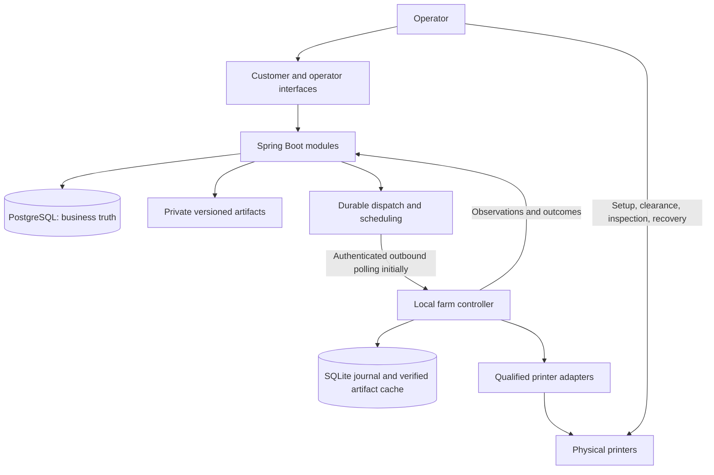

# One3D — target business architecture after V1

Status: **future design, not implemented and not a V1 completion requirement** · Last reviewed: 2026-10-07

Finish [V1](v1-scope.md), record evidence and update the résumé before taking on this scope. [The current architecture](../ARCHITECTURE.md) remains the implementation baseline. This document preserves the manufacturing vision so the portfolio project can grow without implying the complete business platform exists.

The previous serverless architecture is [historical context](history/architecture-2026-09-30.md). Lambda, DynamoDB, Step Functions, IoT Core or a broker are not inherited requirements. Keep Spring Boot and PostgreSQL until a demonstrated need justifies a change.

## 1. Business objective and intake

One3D should deliver an agreed quantity of accepted products made from approved requirements and artifacts under agreed commercial terms. Printing is one operation within that obligation.

OneCreations remains the separate public studio and portfolio. The planned customer domain is `one3d.store`, with an operator experience over the same backend. This does not mean a site has been deployed.

Three paths converge on an order with frozen scope and an approved manufacturing recipe:

1. **Catalog:** a supported product configuration resolves to a validated recipe.
2. **Customer models:** immutable submission, review, preparation and scoped quote precede purchase.
3. **Complex or bulk projects:** personal discussion becomes recorded files, requirements, approvals and terms, followed by the common production pipeline.

An order is not a machine command. Payment creates commercial eligibility. Engineering approval and production release are separate decisions.

## 2. Evolve the modular monolith



A real edge controller is introduced only when physical integration is approved. Begin with simple authenticated outbound communication. Managed device messaging can later replace the transport without changing manufacturing semantics.

Commercial facts, manufacturing intent, commands and observations remain distinct. Sending a command establishes intent; an observed job identity provides evidence of execution.

## 3. Approval, revisions and money

A submission revision includes original files, dimensions/units, material, colour, quantity, finish, intended use and tolerances. Approval covers requirements and exact files together.

```text
Original submission
→ prepared/repaired model
→ component exports
→ versioned slicer project/profile
→ approved machine artifact
→ exact artifact dispatched to an attempt
```

Preserve each transformation instead of overwriting its source. Customer appearance/scope approval and operator manufacturability approval are distinct. Reference exact S3 versions and independently verified full-file digests; never dispatch “the latest file at this key.” Reorders recheck current eligibility, retained artifacts and requirements.

Retiring a recipe from new orders differs from suspending it due to a defect. Suspension must be checked for affected unstarted work, including paid orders.

Before live commerce, define expired quotes, duplicate captures, cancellation/refund races, deposits where needed and authorized release exceptions. A refund request does not prove physical manufacturing stopped. Preserve money facts and reconcile ambiguous provider outcomes.

## 4. Larger and unfamiliar files

The later upload requirement is approximately 200 MB per model, with resumable/multipart transfer, quotas and abandoned-upload cleanup. Add 3MF, OBJ or STEP only with format-specific handling and a supported preparation process.

Archive formats require limits on expanded size, paths and contained files. Parsing/conversion needs constrained resources and isolation. Manual review tools also require safe handling and patching. Customer G-code or embedded printer settings never become approved instructions automatically.

Triage requests before expensive unpaid preparation. Distinguish an estimate from a payable quote. Preparation/design can be a separately priced service while manufacturing authorization stays separate.

Retention distinguishes abandoned uploads, customer sources, manufacturing artifacts and financial records. Deleting required artifacts can disable reproducible reorders; the product must communicate that consequence.

## 5. Parts, plates, attempts and people

Multi-part products add:

- Component identities and required quantities.
- Approved plate definitions with expected output.
- Released plate jobs and execution attempts.
- Accepted, rejected and rework quantities.
- Component allocations to assembly.
- Cleanup, finishing, QC, packing and fulfilment tasks.

Six planned plates can require seven attempts after a failure. Completion produces candidate parts; QC establishes accepted output. Partial acceptance preserves usable quantities and creates only missing work using approved replacement artifacts.

Assembly requires available accepted quantities and reserves/consumes them so another task cannot use the same physical components. Start with typed tasks and a small supported process model, not an arbitrary workflow editor.

The operator interface answers “What needs my action?”: uncertain execution, beds, setup, review, incomplete orders, assembly/QC and packing. Record active human time separately from elapsed cooling, drying or waiting time.

## 6. Bed clearance and readiness

Connectivity, observed execution, bed occupancy, holds, configuration and reservation are independent facts. Online/idle does not prove ready.

A clearance record identifies the printer, relevant physical plate/cycle, operator and configuration. Consume it at the next start. Failed or cancelled prints also need clearance because debris may remain.

Begin with human confirmation, suitable spare plates and identified order bins. QR codes help identify tasks but cannot prove clearance. Vision remains advisory until reliability is established.

Mechanical removal, automatic plate exchange and robotics need separate preconditions, failure detection and recovery. A Boolean `autoClear` does not express these guarantees.

## 7. Qualified physical execution

The real controller needs a durable journal, verified artifact cache, serialized ownership per printer, local precondition checks and restart reconciliation.

Each adapter declares verified capabilities: upload, start, pause/cancel, observations, job identity and acknowledgement meaning. Do not assume models or firmware offer equal guarantees. The current X1C begins with observation and supervised operation once its actual integration path is checked.

### Start protocol

1. Atomically reserve printer/job and create attempt, command and pending dispatch.
2. Edge persists command identity/payload hash; duplicate identity returns its recorded outcome.
3. Verify artifact, configuration, authorization and clearance locally.
4. Persist `START_INTENT` and consume clearance before physical start.
5. Correlate acknowledgement and observations with the attempt.
6. Persist and report outcomes.

A printer can start before the controller crashes without recording success. On recovery, query actual state and correlate a sufficiently strong job identity. If evidence is insufficient, retain ownership and enter `RECONCILIATION_REQUIRED`; never blindly resend or reassign.

Generation tokens reject stale cloud commands at the edge. They cannot stop an old controller with independent printer access when the printer does not enforce those tokens. Replacement requires isolation/revocation and physical reconciliation; automatic failover alone is insufficient.

Initially, known running jobs continue through internet loss under native controls while new cloud-dependent starts stop. An offline authorized queue is a later explicit tradeoff because disconnected controllers cannot immediately learn about cancellations or suspensions.

Software approval does not replace suitable equipment, maintenance, material qualification, local controls or operating procedures. Cloud connectivity is not an emergency stop.

## 8. Scheduling and capacity

When manual decisions become a bottleneck, use an explainable policy:

1. Enforce release, capability, configuration, artifact and ownership constraints.
2. Protect threatened delivery promises and prevent starvation.
3. Prefer work completing nearly finished orders when appropriate.
4. Consider material/setup changes, turnover time and operator availability.
5. Account for downstream assembly/QC capacity.
6. Record the assignment reason.

Plans can change; running or uncertain attempts cannot be casually reshuffled. Reservations remain atomic and unique. Loaded colour should not indefinitely delay an order's last required component.

Measure waiting after completion, setup, human effort, rework and complete-order throughput. The next printer or automation purchase addresses a measured bottleneck and available cash, as described in [the business plan](business-plan.md). Utilization alone is not the outcome.

Cross-order packing, nesting, optimization solvers, machine learning and workforce scheduling are later possibilities, not default features.

## 9. Recovery and operational evidence

Preserve errors and attempts rather than overwriting them. Latest observations and significant events are enough initially; high-frequency telemetry requires explicit retention and volume limits.

- Stale/offline observations preserve execution ownership.
- Duplicate completion cannot create duplicate accepted inventory.
- Manual printing outside One3D triggers reconciliation.
- Lost/corrupt edge journals put affected devices on hold.
- Backup restoration stops dispatch until restored cloud commands are reconciled with edge and physical history.
- Confirmed failure permits another attempt only after inspection, setup checks and authorization.

Expand metrics to throughput, first-pass yield, operator effort, missing-part delays, rework cost and queue age. Keep high-cardinality identities in logs, not metric labels.

## 10. Expansion gates

| Addition | Evidence or prerequisite |
|---|---|
| More formats / larger files | Actual requests; validation, retention and transfer failure behavior defined |
| Multi-part recipes / assembly | Real product requires components; quantity and acceptance rules agreed |
| Live payments | Commercial policies, provider setup, security and recovery reviewed |
| Real printer control | Capabilities verified, supervised tests and recovery procedure completed |
| Additional printers | Paid demand, capacity bottleneck and working capital justify purchase |
| Automatic scheduling | Manual decisions repeatedly consume time or miss commitments |
| Inventory / detailed costing | Reliable operational records support stock and cost decisions |
| Automated bed handling | Turnover burden justifies equipment and exception handling |
| Broker / device platform | Specific communication, throughput or management need exists |
| Multiple sites | Actual second site requires local authority, inventory and outage behavior |
| PrintBack | Real collection/processing route and auditable material records exist |

PrintBack and circularity claims remain in [their separate business document](printback.md). Do not add credit ledgers, environmental claims or historical regulatory assumptions to V1. Verify applicable requirements when that business work begins.

Promote each capability through planned → implemented → tested → deployed/operated evidence. Keep the completed V1 available as a portfolio milestone while future work grows through separately bounded increments.
